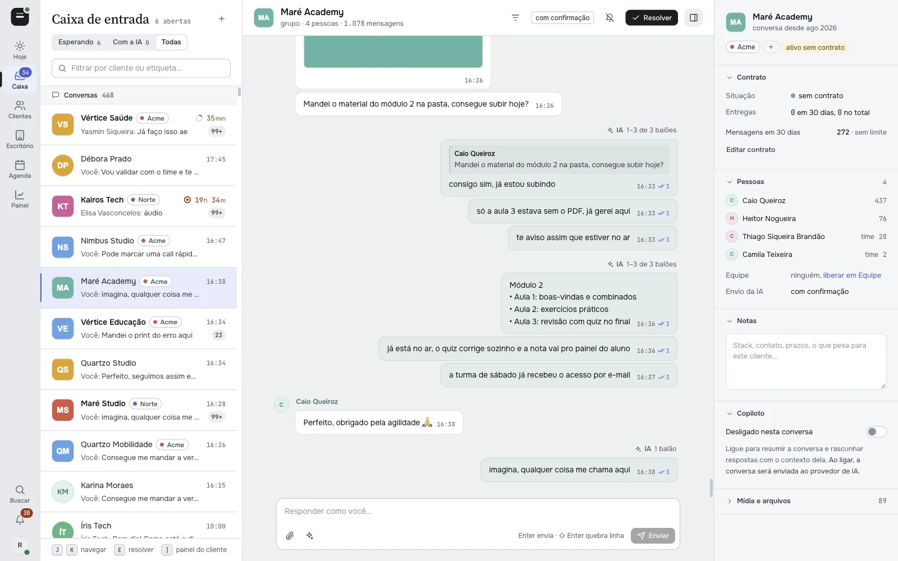
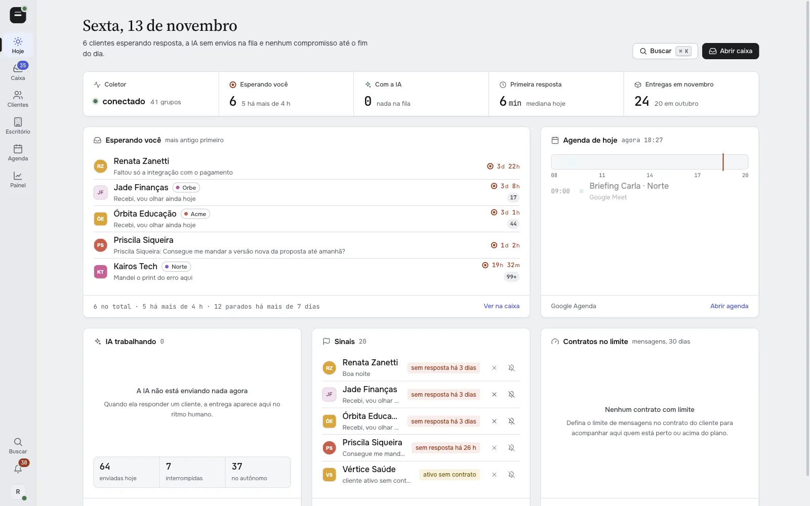
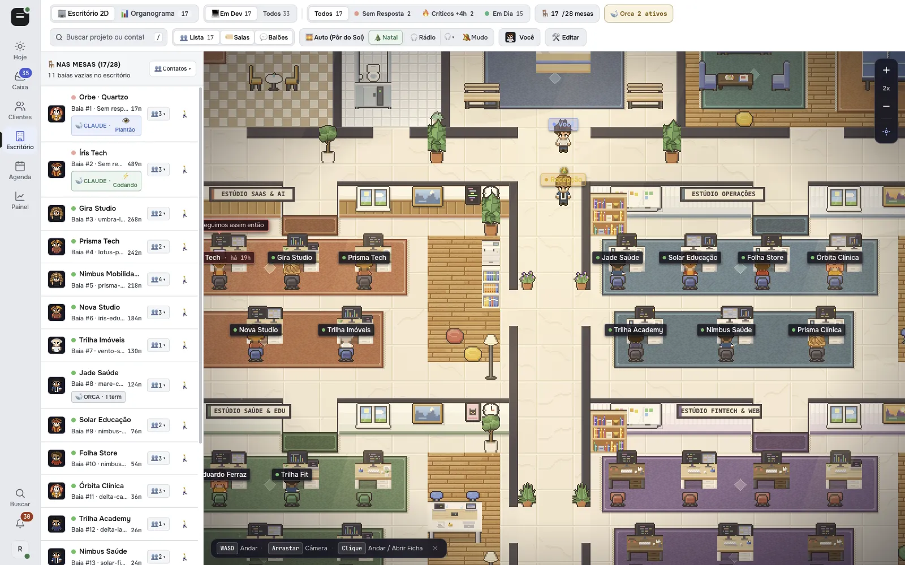
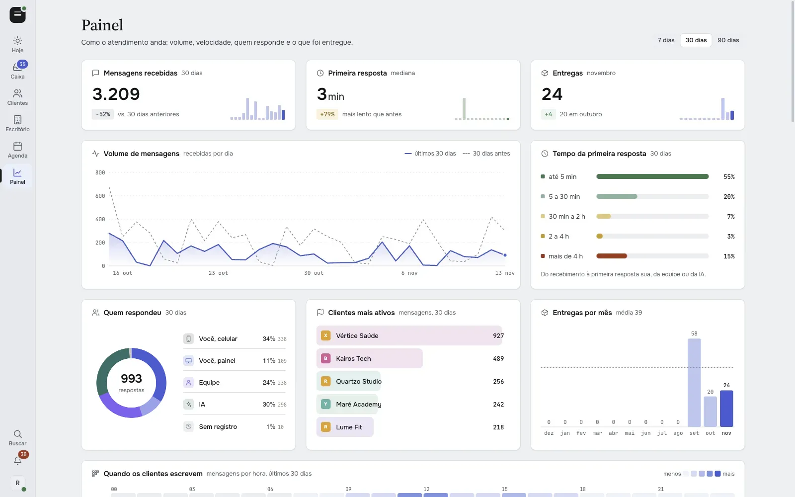
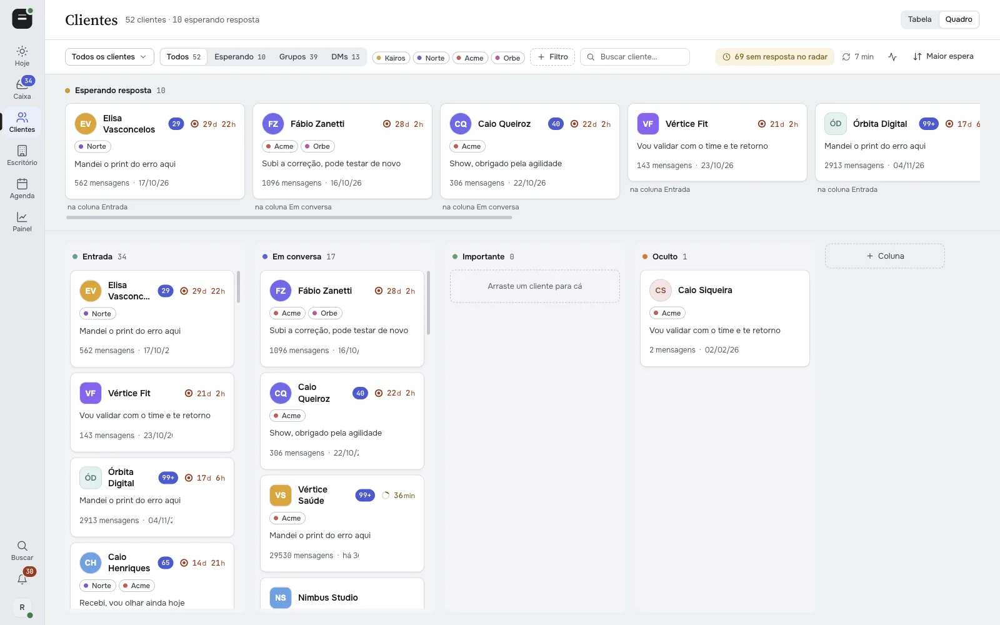
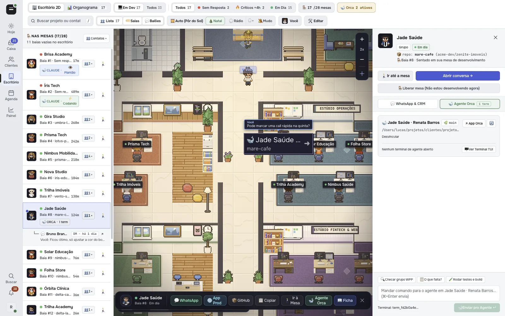
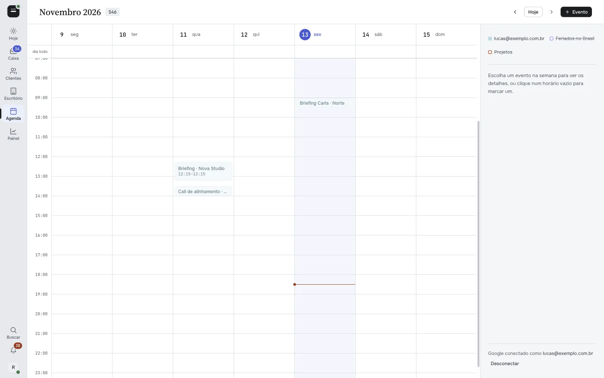

<p align="center"></p>

<h1 align="center">WACrew</h1>

<p align="center">
  <b>Open-source WhatsApp AI automation for teams that serve clients in group chats.</b><br>
  An inbox sorted by who has waited longest, replies written in your own voice and delivered at a human pace,<br>
  a client CRM, a live 2D office, and an MCP server so your coding agent can work the chats too.
</p>

<p align="center">
  <a href="./LICENSE"></a>
  <a href="https://nodejs.org"></a>
  <a href="https://github.com/WhiskeySockets/Baileys"></a>
  <a href="https://modelcontextprotocol.io"></a>
</p>

<p align="center"><a href="https://wacrew.com.br">wacrew.com.br</a> · <a href="./README.pt-BR.md">Leia em português</a></p>



## Why

If you sell or deliver work over WhatsApp, you know the scene: forty client groups, a four-minute voice note in the middle of a thread, the bug screenshot lost in the scroll, and the client who wrote three days ago that nobody saw.

A chatbot does not fix that. Canned answers read like a robot, clients notice, and the relationship cools down. What you need is someone who reads everything, answers the way you would, and never lets anyone wait. WACrew is that someone, and you stay in control of every message.

**The engine that makes it read like a person:**

| 2 | 25+ | 60 | ~30 s |
|:---:|:---:|:---:|:---:|
| writing skills: your voice and client conduct | code rules that block robot tells | history messages read before replying | median until typing starts in a live chat |

## What it does

**Nobody waits.** Every group and direct chat lands in one queue sorted by waiting time. A client's group and their private chats show up together, back-to-back messages collapse into one block, and voice notes arrive transcribed.

**Writes like you, delivers like a person.** The AI reads the history and writes with your punctuation, openings and rhythm, measured on your own past messages. Before anything leaves, a deterministic review blocks robot clichés, repeated apologies and duplicate bubbles. Delivery comes with read receipt, typing indicator and pauses, and it stops on its own if the client writes again or you answer from your phone.

**You stay in control.** In *Confirm* mode (the default) nothing is sent without your OK. *Autonomous* mode is turned on per chat. Every message records who wrote it: you on the phone, you on the panel, a teammate, or the AI.

| | |
|---|---|
|  **Today.** Who is waiting and for how long, what the AI is doing, signals and today's agenda. |  **2D office.** One desk per project. When a client writes, the desk turns red right away, with sound. |
|  **Dashboard.** Volume, first-reply time, who answered, busiest clients and deliveries per month. |  **Clients.** Table and board views with contract, deliveries and waiting time per client. |
|  **Agent bridge (optional).** If you use [Orca](https://onorca.dev), the client drawer shows the coding agent working on that project's repo and lets you send it commands. |  **Calendar.** Your Google Calendar inside the panel, editable by you or by the AI. |

More screens in [`docs/screenshots/`](docs/screenshots): org chart, team access, notifications, project links, settings and the command palette.

## How it works

```
                          ┌────────────────────────────┐
  WhatsApp ─► collector ─►│  data/<chat>/              │◄─► web panel (Next.js, :3000)
  (Baileys)   (daemon)    │  messages.jsonl + media    │
                          │  transcripts, notes, state │◄─► MCP server (your coding agent)
                          └─────────────┬──────────────┘
                     transcriber (MLX on Apple Silicon, or an API)
```

- **Collector** (`src/`): a Baileys daemon (WhatsApp Web multi-device, no browser). Baileys is isolated behind ports and adapters in `src/whatsapp/`. It writes every message, reaction and media file to `data/<chat>/` and runs the delivery queue that sends replies at a human pace.
- **Panel** (`web/`): Next.js 16 + React 19. Inbox, conversation view, clients, dashboard, calendar, team, 2D office, settings. Live updates over SSE.
- **MCP server** (`web/mcp/server.ts`): 36 tools over the same data, for Claude Code, Codex, Qwen Code or any MCP client.
- **Transcriber** (`transcriber/`): Whisper large-v3 via MLX, loaded on demand and released when idle. Off a Mac, set `TRANSCRIBE_BACKEND=openrouter`.
- **Local or cloud.** Run everything on your machine, or deploy the collector and panel 24/7 with the included `Dockerfile` (a `railway.json` is provided). The local MCP can read straight from the cloud panel (`WAC_MCP_REMOTE=1`), downloading media on demand.

## Quick start

Requirements: Node.js 20+, `ffmpeg`, and a WhatsApp account to pair. Local transcription needs Apple Silicon (`uv tool install mlx-whisper`).

```bash
git clone https://github.com/sumioshi/wacrew && cd wacrew
npm install && npm --prefix web install
cp .mcp.json.example .mcp.json
npm run dev          # collector + panel + transcriber + notifier
```

Open `http://localhost:3000/config`, scan the QR code (WhatsApp › Linked devices › Link a device), pick the groups to follow and mark who is on your team. The session is saved in `auth/` and reconnects on its own.

**Run it 24/7 on a VPS.** The repo ships a `docker-compose.yml` with a persistent volume for the WhatsApp session and data:

```bash
cp .env.example .env   # set PANEL_USER and PANEL_PASS
docker compose up -d --build
```

[](https://www.hostinger.com/vps-hosting?REFERRALCODE=ORISHODIRBUH)

<sub>Referral link: you get a discount on the VPS and the project earns a commission that helps keep it maintained.</sub>

**Other clouds.** Build the `Dockerfile` on any host (Railway works out of the box) with a volume at `/data`. Set `PANEL_USER` and `PANEL_PASS` to protect the panel with login; without them the panel is open, which is only fine on localhost.

## MCP tools

The server is registered by `.mcp.json` (project scope). Claude Code and Qwen Code read it and ask for approval on first use.

| Area | Tools |
|---|---|
| Read | `listar_grupos`, `ler_mensagens`, `buscar`, `listar_contatos`, `caixa_de_entrada`, `novidades`, `resumo_do_dia`, `ler_notas`, `estado_triagem` |
| Media | `transcrever`, `ver_imagem`, `ver_video`, `assistir_video`, `ler_documento` |
| Reply | `preparar_resposta`, `revisar_texto`, `responder`, `responder_midia`, `editar_mensagem`, `reagir`, `status_envio`, `cancelar_envio` |
| Triage and CRM | `marcar_resolvido`, `silenciar_grupo`, `anotar`, `etiquetar`, `alertar_chat`, `definir_modo`, `definir_contrato`, `registrar_feature`, `dashboard`, `editar_perfil` |
| Calendar | `agenda_ver`, `agenda_marcar`, `agenda_editar`, `agenda_apagar` |

Highlights:

- `buscar` finds text **inside transcripts** too.
- `ver_imagem` and `ver_video` hand the media to the model, which is handy for bug screenshots. `assistir_video` has a Gemini model watch a video with its audio, attached or from a link.
- `responder` returns a **ticket**. The message leaves later at a human pace: seconds in a live chat, minutes to hours in a cold one. The ticket is interrupted if the client writes or you answer by hand. `status_envio` tracks it and `cancelar_envio` cancels it.
- `preparar_resposta` returns your recent style and what the client left open. Pass 2 or 3 `candidatos` to `responder` and the least out-of-character one is sent.

Tool names are in Portuguese because the project started in Brazil. Descriptions are clear enough for any model.

## Configuration

Everything has a default. Copy `.env.example` to `.env` and adjust what you need.

| Variable | What it does |
|---|---|
| `PANEL_USER`, `PANEL_PASS` | Panel login. Required when the panel is reachable from the internet. |
| `OPENROUTER_API_KEY` | Posture check before sending, video watching and API transcription. |
| `COPILOT_PROVIDER`, `ANTHROPIC_API_KEY`, `COPILOT_OPENAI_API_KEY` | The in-panel copilot (Anthropic or any OpenAI-compatible API). |
| `TRANSCRIBE_BACKEND` | `mlx` (local, default on a Mac) or `openrouter`. |
| `WAC_MCP_REMOTE`, `WAC_CLOUD_URL`, `WAC_CLOUD_USER`, `WAC_CLOUD_PASS` | Point the local MCP and sync at your cloud panel. |
| `WAC_NOME_OPERADOR`, `WAC_SKILL_VOZ` | Your first name and the voice skill the AI loads before writing. |
| `GOOGLE_CLIENT_ID`, `GOOGLE_CLIENT_SECRET` | Calendar and Google sign-in. |
| `CONTROL_TOKEN` | Bearer token for the external control API. |
| `DATA_DIR`, `AUTH_DIR`, `LOG_LEVEL` | Where data and the session live, and log verbosity. |

There is also a public REST API documented in [`docs/api-v1.md`](docs/api-v1.md).

## What gets stored

```
data/<chat>/
  messages.jsonl     one line per message (the AI's "database")
  reactions.jsonl    emoji reactions
  log.md             the same conversation, human-readable
  audio/ video/ image/ document/ transcripts/
```

`data/`, `auth/`, `.env` and `groups.config.json` are git-ignored. Never commit them.

## Read this before using it

- **This is not the official WhatsApp API.** WACrew links to your account as one more device, through Baileys. It is built to answer people who already talk to you. Bulk messaging and cold outreach can get your number banned.
- **No old history.** Capture starts when you pair the number.
- **Sending is real.** The panel and the control API send messages as you. Keep them on localhost or behind login.
- WACrew is an independent project, not affiliated with WhatsApp or Meta.

## Contributing

Issues and pull requests are welcome.

```bash
npm test            # Vitest
npx tsc --noEmit    # typecheck
```

Shared logic between the panel and the MCP lives in `web/lib/`. See [CONTRIBUTING.md](./CONTRIBUTING.md).

## License

[Apache 2.0](./LICENSE) © [Rodrigo Sumioshi](https://rodrigosumioshi.com). See [NOTICE](./NOTICE).
