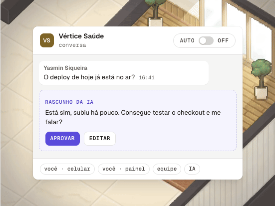
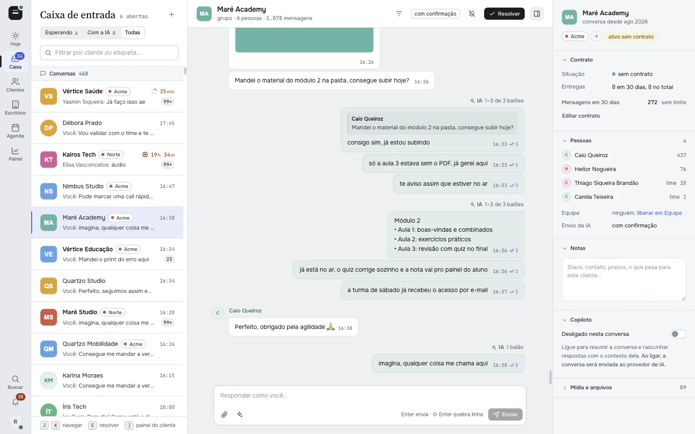
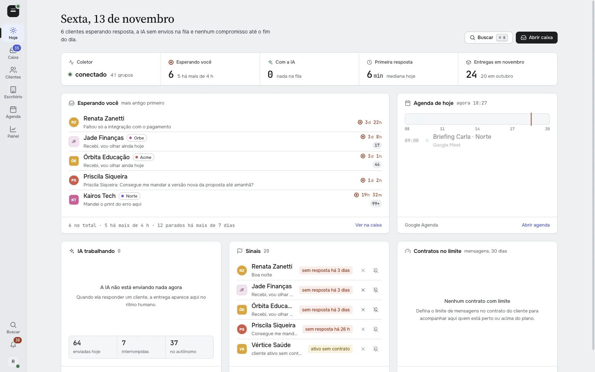
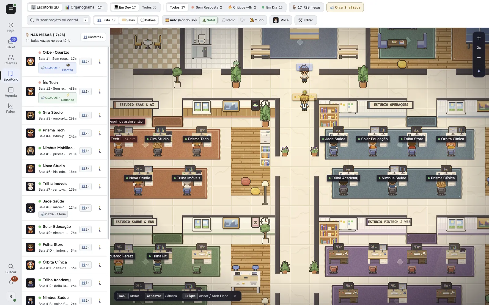
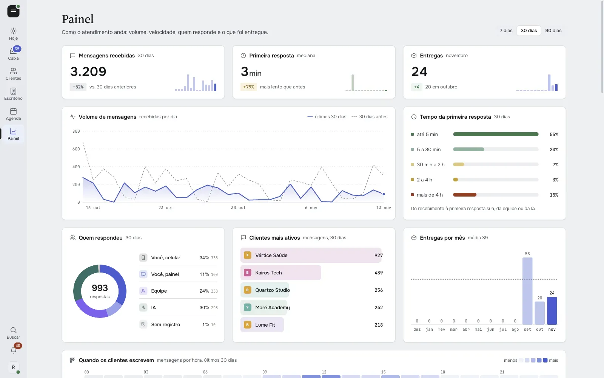
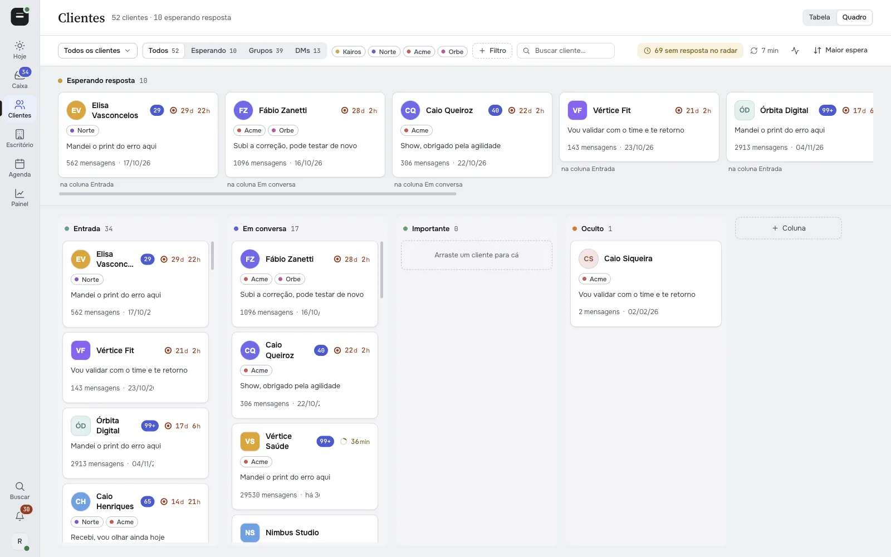
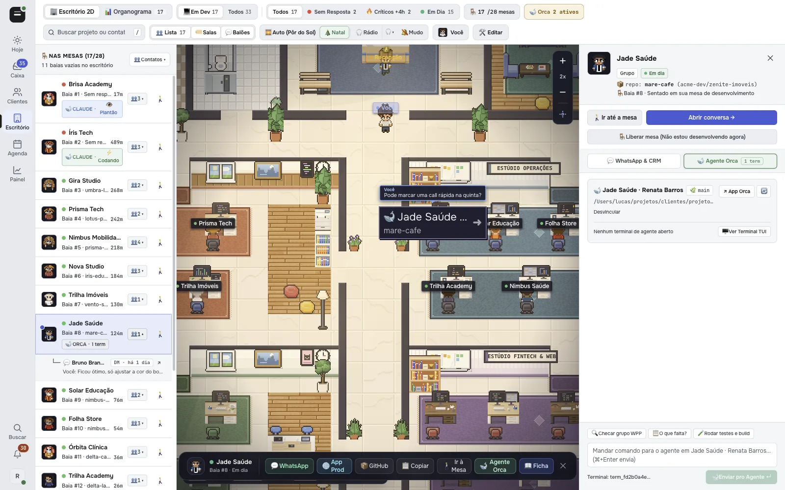
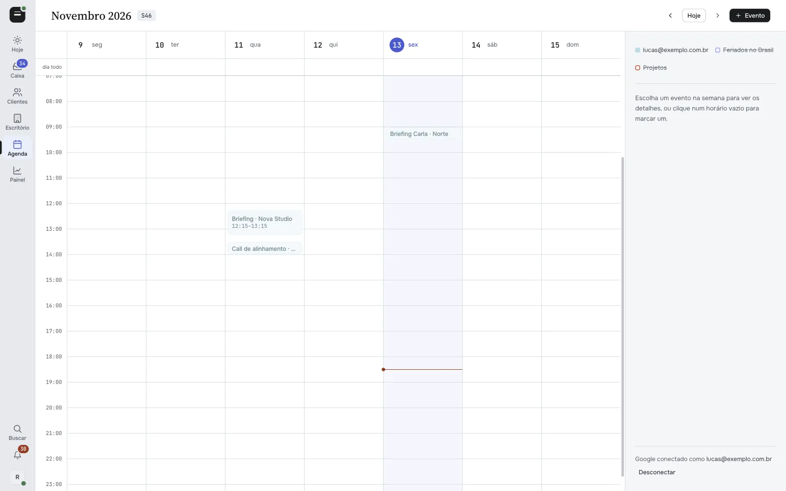

<p align="center"></p>

<h1 align="center">WACrew</h1>

<p align="center">
  <b>Automação de WhatsApp com IA, de código aberto, para quem atende clientes em grupo.</b><br>
  Uma fila por tempo de espera, respostas escritas na sua voz e entregues no ritmo de gente,<br>
  um CRM de clientes, um escritório 2D ao vivo e um servidor MCP para o seu agente de código atender também.
</p>

<p align="center">
  <a href="./LICENSE"></a>
  <a href="https://nodejs.org"></a>
  <a href="https://github.com/WhiskeySockets/Baileys"></a>
  <a href="https://github.com/sponsors/sumioshi"></a>
  <a href="https://modelcontextprotocol.io"></a>
</p>

<p align="center"><a href="https://wacrew.com.br">wacrew.com.br</a> · <a href="./README.md">Read in English</a></p>

<p align="center"></p>

## Por quê

Quem vende ou entrega trabalho pelo WhatsApp conhece a cena: quarenta grupos de cliente, um áudio de quatro minutos no meio da conversa, o print do bug perdido no scroll e o cliente que mandou mensagem há três dias e ninguém viu.

Chatbot não resolve. Resposta pronta tem cara de robô, o cliente sente e a relação esfria. O que falta é alguém que leia tudo, responda como você e nunca deixe ninguém esperando. O WACrew é esse alguém, e você continua no controle de cada mensagem.



**O motor que faz a IA parecer gente:**

| 2 | 25+ | 60 | ~30 s |
|:---:|:---:|:---:|:---:|
| skills de escrita: a sua voz e a conduta com cliente | regras em código que barram cara de robô | mensagens do histórico lidas antes de responder | de mediana até começar a digitar numa conversa ativa |

## O que faz

**Ninguém fica esperando.** Todo grupo e conversa individual cai numa fila por tempo de espera. Grupo e conversas individuais do mesmo cliente aparecem juntos, mensagens seguidas viram um bloco só e o áudio chega transcrito.

**Escreve como você, entrega como gente.** A IA lê o histórico e escreve com a sua pontuação, as suas aberturas e o seu ritmo, medidos nas suas próprias mensagens. Antes de sair, uma revisão em código barra clichê de robô, desculpa repetida e balão igual ao anterior. A entrega tem visto, digitando e pausa, e para sozinha se o cliente escrever de novo ou se você responder pelo celular.

**Você no controle.** No modo *Confirmar* (o padrão) nada sai sem o seu OK. O modo *Autônomo* é ligado por conversa. Cada mensagem registra quem escreveu: você pelo celular, você pelo painel, alguém da equipe ou a IA.

| | |
|---|---|
|  **Hoje.** Quem espera e há quanto tempo, o que a IA está fazendo, sinais e a agenda do dia. |  **Escritório 2D.** Uma mesa por projeto. Chegou mensagem, a mesa fica vermelha na hora, com som. |
|  **Painel.** Volume, tempo de primeira resposta, quem respondeu, clientes mais ativos e entregas por mês. |  **Clientes.** Tabela e quadro, com contrato, entregas e tempo de espera de cada cliente. |
|  **Ponte com o agente (opcional).** Se você usa o [Orca](https://onorca.dev), a ficha do cliente mostra o agente de código trabalhando no repositório daquele projeto e deixa você mandar comandos para ele. |  **Agenda.** O seu Google Agenda dentro do painel, editável por você ou pela IA. |

Mais telas em [`docs/screenshots/`](docs/screenshots): organograma, acesso da equipe, notificações, links de projeto, configurações e a paleta de comandos.

## Como funciona

```
                          ┌────────────────────────────┐
  WhatsApp ─► coletor ──► │  data/<chat>/              │◄─► painel web (Next.js, :3000)
  (Baileys)   (daemon)    │  messages.jsonl + mídia    │
                          │  transcrições, notas       │◄─► servidor MCP (seu agente de código)
                          └─────────────┬──────────────┘
                     transcrição (MLX no Apple Silicon, ou por API)
```

- **Coletor** (`src/`): daemon Baileys (WhatsApp Web multidispositivo, sem navegador). O Baileys fica isolado atrás de portas e adaptadores em `src/whatsapp/`. Grava toda mensagem, reação e mídia em `data/<chat>/` e roda a fila que entrega as respostas no ritmo humano.
- **Painel** (`web/`): Next.js 16 + React 19. Caixa de entrada, conversa, clientes, painel, agenda, equipe, escritório 2D e configurações. Atualiza ao vivo por SSE.
- **Servidor MCP** (`web/mcp/server.ts`): 36 ferramentas sobre os mesmos dados, para Claude Code, Codex, Qwen Code ou qualquer cliente MCP.
- **Transcrição** (`transcriber/`): Whisper large-v3 via MLX, carregado sob demanda e liberado quando ocioso. Fora do Mac, use `TRANSCRIBE_BACKEND=openrouter`.
- **Local ou nuvem.** Rode tudo na sua máquina, ou suba o coletor e o painel 24 horas com o `Dockerfile` incluso (tem `railway.json` pronto). O MCP local pode ler direto do painel na nuvem (`WAC_MCP_REMOTE=1`), baixando a mídia sob demanda.

## Começar

Requisitos: Node.js 20+, `ffmpeg` e uma conta de WhatsApp para parear. A transcrição local precisa de Apple Silicon (`uv tool install mlx-whisper`).

```bash
git clone https://github.com/sumioshi/wacrew && cd wacrew
npm install && npm --prefix web install
cp .mcp.json.example .mcp.json
npm run dev          # coletor + painel + transcrição + notificador
```

Abra `http://localhost:3000/config`, escaneie o QR (WhatsApp › Aparelhos conectados › Conectar um aparelho), escolha os grupos que quer acompanhar e marque quem é da sua equipe. A sessão fica salva em `auth/` e reconecta sozinha.

**Rodar 24 horas numa VPS.** O WACrew só guarda o que chega enquanto está ligado: com o computador desligado, as mensagens desse período não entram no histórico nem na fila. O repositório traz um `docker-compose.yml` com volume persistente para a sessão do WhatsApp e os dados:

```bash
cp .env.example .env   # defina PANEL_USER e PANEL_PASS
docker compose up -d --build
```

[](https://www.hostinger.com/br/servidor-vps?REFERRALCODE=ORISHODIRBUH)

<sub>Link de indicação: você ganha desconto na VPS e o projeto recebe uma comissão que ajuda a mantê-lo.</sub>

**Outras nuvens.** Faça o build do `Dockerfile` em qualquer servidor (na Railway funciona direto) com um volume em `/data`. Defina `PANEL_USER` e `PANEL_PASS` para proteger o painel com login; sem elas o painel fica aberto, o que só serve no localhost.

## Ferramentas MCP

O servidor é registrado pelo `.mcp.json` (escopo do projeto). Claude Code e Qwen Code leem esse arquivo e pedem aprovação no primeiro uso.

**Pelo npm, sem clonar.** Com o painel rodando numa VPS, adicione o MCP em qualquer cliente com o [`wacrew-mcp`](./packages/mcp):

```bash
claude mcp add wacrew -e WAC_CLOUD_URL=https://seu-painel.exemplo.com \
  -e WAC_CLOUD_USER=admin -e WAC_CLOUD_PASS=troque-esta-senha -- npx -y wacrew-mcp
```

| Área | Ferramentas |
|---|---|
| Ler | `listar_grupos`, `ler_mensagens`, `buscar`, `listar_contatos`, `caixa_de_entrada`, `novidades`, `resumo_do_dia`, `ler_notas`, `estado_triagem` |
| Mídia | `transcrever`, `ver_imagem`, `ver_video`, `assistir_video`, `ler_documento` |
| Responder | `preparar_resposta`, `revisar_texto`, `responder`, `responder_midia`, `editar_mensagem`, `reagir`, `status_envio`, `cancelar_envio` |
| Triagem e CRM | `marcar_resolvido`, `silenciar_grupo`, `anotar`, `etiquetar`, `alertar_chat`, `definir_modo`, `definir_contrato`, `registrar_feature`, `dashboard`, `editar_perfil` |
| Agenda | `agenda_ver`, `agenda_marcar`, `agenda_editar`, `agenda_apagar` |

Destaques:

- `buscar` acha texto **dentro das transcrições** também.
- `ver_imagem` e `ver_video` entregam a mídia para o modelo enxergar, o que ajuda muito com print de bug. `assistir_video` faz um modelo Gemini assistir o vídeo com áudio, anexado ou por link.
- `responder` devolve um **ticket**, e a mensagem sai depois, no ritmo humano: segundos numa conversa ativa, minutos a horas numa fria. A entrega é interrompida se o cliente escrever ou se você responder na mão. `status_envio` acompanha e `cancelar_envio` cancela.
- `preparar_resposta` devolve o seu estilo recente e o que o cliente deixou em aberto. Mande 2 ou 3 `candidatos` no `responder` e sai o que menos destoa de você.

## Configuração

Tudo tem padrão. Copie `.env.example` para `.env` e ajuste o que precisar.

| Variável | Para que serve |
|---|---|
| `PANEL_USER`, `PANEL_PASS` | Login do painel. Obrigatório quando o painel fica acessível pela internet. |
| `OPENROUTER_API_KEY` | Checagem de postura antes do envio, vídeo e transcrição por API. |
| `COPILOT_PROVIDER`, `ANTHROPIC_API_KEY`, `COPILOT_OPENAI_API_KEY` | O copiloto do painel (Anthropic ou qualquer API compatível com OpenAI). |
| `TRANSCRIBE_BACKEND` | `mlx` (local, padrão no Mac) ou `openrouter`. |
| `WAC_MCP_REMOTE`, `WAC_CLOUD_URL`, `WAC_CLOUD_USER`, `WAC_CLOUD_PASS` | Apontam o MCP local e a sincronização para o seu painel na nuvem. |
| `WAC_NOME_OPERADOR`, `WAC_SKILL_VOZ` | O seu primeiro nome e a skill de voz que a IA carrega antes de escrever. |
| `GOOGLE_CLIENT_ID`, `GOOGLE_CLIENT_SECRET` | Agenda e login com Google. |
| `CONTROL_TOKEN` | Token da API de controle externa. |
| `DATA_DIR`, `AUTH_DIR`, `LOG_LEVEL` | Onde ficam os dados e a sessão, e o nível de log. |

Tem também uma API REST pública, documentada em [`docs/api-v1.md`](docs/api-v1.md).

## O que fica gravado

```
data/<chat>/
  messages.jsonl     uma linha por mensagem (o "banco" da IA)
  reactions.jsonl    reações
  log.md             a mesma conversa, legível
  audio/ video/ image/ document/ transcripts/
```

`data/`, `auth/`, `.env` e `groups.config.json` ficam fora do git. Nunca versione.

## Antes de usar

- **Não é a API oficial do WhatsApp.** O WACrew conecta como um aparelho a mais na sua conta, pelo Baileys. Foi feito para atender quem já fala com você. Disparo em massa e abordagem fria podem bloquear o número.
- **Sem histórico antigo.** A captura começa quando você pareia o número.
- **O envio é real.** O painel e a API de controle mandam mensagem como você. Deixe no localhost ou atrás de login.
- O WACrew é um projeto independente, sem vínculo com o WhatsApp ou a Meta.

## Contribuindo

Se o WACrew te poupa tempo, considere [patrocinar o projeto](https://github.com/sponsors/sumioshi). É o que paga as horas que mantêm ele vivo.

Issues e pull requests são bem-vindos.

```bash
npm test            # Vitest
npx tsc --noEmit    # typecheck
```

A lógica compartilhada entre o painel e o MCP fica em `web/lib/`. Veja o [CONTRIBUTING.md](./CONTRIBUTING.md).

## Patrocinadores

O WACrew é gratuito e de código aberto. Quem patrocina mantém o projeto vivo e ganha nome ou logo aqui.

<a href="https://github.com/sponsors/sumioshi"></a>

## Licença

[Apache 2.0](./LICENSE) © [Rodrigo Sumioshi](https://rodrigosumioshi.com). Veja o [NOTICE](./NOTICE).
